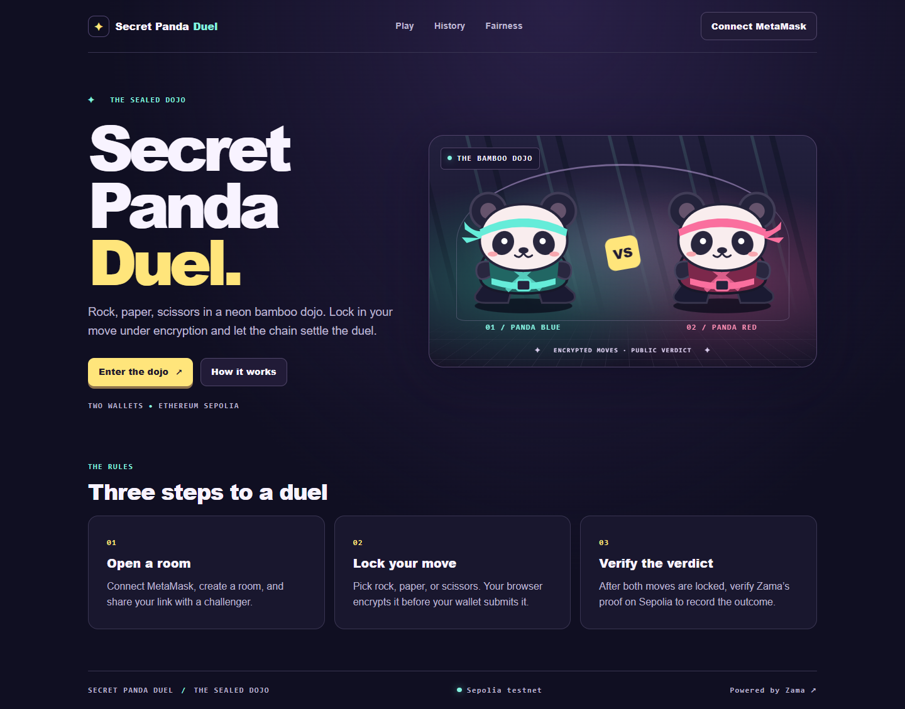

# Secret Panda Duel

Two panda warriors face off in a neon bamboo dojo. Each player locks an encrypted Rock, Paper, or Scissors move. The duel contract evaluates the moves with Zama FHEVM and records the outcome after verifying a Zama KMS proof.

A public first move lets the second player choose its counter. Here, both moves stay encrypted through submission and evaluation. Only the outcome is made publicly decryptable. After both moves lock, a participant who knows their own choice can infer the opponent's choice from the outcome.

## Play a round

The V2 contract on Sepolia supports four-digit room codes, public wallet usernames, and matches of up to three rounds. The first player to win two rounds wins the match. If neither player has two wins after three rounds, the match is a draw. The frontend also recognizes the original single-round contract.

1. Connect MetaMask on Ethereum Sepolia. Player A creates a room and copies the invitation link.
2. Player B opens it in a separate browser profile with a different wallet and joins as Panda Red.
3. Each player selects a move and confirms the encrypted submission. Refresh either tab to restore the room directly from Sepolia.
4. Once both moves are locked, select **Verify & finalize**. The UI fetches the Zama proof, simulates verification, and asks the wallet to submit the finalization.
5. On V2, repeat for the next round until the scoreboard shows a match result. Set or edit your public username from the Play lobby. Open match history or request a rematch after the match.

## Local setup

Use Node.js 24 and npm from the repository root.

```sh
npm ci
npm run compile
npm test
npm run typecheck
npm run build
npx playwright install chromium
npm run test:web
npm run dev
```

Visit `http://localhost:3000`. The landing, play, history and fairness pages load without a deployment. To make real gameplay available, configure `apps/web/.env.local` with the deployed Sepolia address. The frontend uses Next.js App Router, React, TypeScript, Tailwind, Wagmi, Viem, TanStack Query and the Zama React SDK. The contracts use Solidity 0.8.27 and Zama's official Hardhat integration.

## Deploy and verify

Follow [deployment instructions](docs/DEPLOYMENT.md) to deploy the contract to Sepolia, verify it, and configure Vercel. Follow [testing instructions](docs/TESTING.md) for the separate live smoke test and two-wallet browser walkthrough.

| Evidence | Link |
| --- | --- |
| Sepolia contract V1 | [`0x7d928e377bd880e7cc5e1befec9a2d583bd561ee`](https://sepolia.etherscan.io/address/0x7d928e377bd880e7cc5e1befec9a2d583bd561ee) |
| Sepolia contract V2 | [`0x2bd5f625f51fa7c515eed84ccbedc08d328133fe`](https://sepolia.etherscan.io/address/0x2bd5f625f51fa7c515eed84ccbedc08d328133fe) |
| Live DApp | [secret-panda-duel.vercel.app](https://secret-panda-duel.vercel.app/) |
| Demo video | Pending recording after the two-wallet demo |

## Screenshots



[Mobile landing page](docs/screenshots/dojo-mobile.png) · [Live round capture checklist](docs/DEMO_SCRIPT.md#screenshots-to-capture)

## Repository layout

```text
apps/web/           Next.js interface, wallet and SDK integration
packages/contracts/ Solidity, Hardhat deploy and local FHEVM tests
scripts/            Generated frontend ABI export
docs/               Architecture, security, deployment and bounty package
```

Read the [architecture](docs/ARCHITECTURE.md), [FHE design](docs/FHE_DESIGN.md), [threat model](docs/SECURITY.md), [research](docs/RESEARCH.md), and [submission checklist](docs/BOUNTY_SUBMISSION.md). Finalization depends on Sepolia and Zama service availability. Public lobbies are first-come. The project has no wagering.
