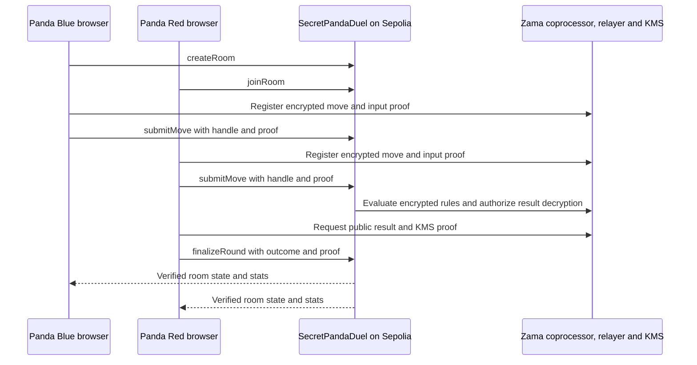

# Architecture

The second submission evaluates the circuit regardless of who submits first. Either player or any other address can submit a valid finalization. The UI loads the room directly from Sepolia on navigation or refresh, polls the room every four seconds, and refetches after confirmed writes. A parsed room-creation event gives the creator the correct ID even when other rooms are created concurrently. Match history reads a capped page of room IDs in reverse finalization order and then loads their room records.

- `apps/web/app` contains App Router pages and wallet/query providers.
- `apps/web/components` contains the dojo UI and browser-only Zama provider.
- `apps/web/lib` contains chain configuration, the generated ABI, and shared transaction handling.
- `packages/contracts` contains Solidity, local tests, Hardhat deployment, and the opt-in Sepolia smoke test.
- `scripts/export-abi.mjs` exports the checked-in ABI from the compiler artifact.

There is no application database or game server. Wallets sign transaction requests, and the contract governs phases, timeouts, results, stats, and rematches.
